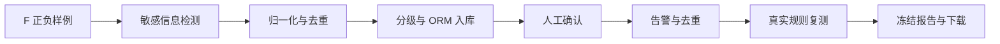

# D 模块本地闭环与联调交接

> v1.0，2026-10-23，D；分支 `feature/d-closure-20261023`，集成候选，待评审。主分支基线 `42bc12f`。对应今日简报与两份 JSON 验收记录见文末。

## 1. 今日完成的工作

将此前分别交付的 T23、T24、T25、T26 和 T47 放到一个与最新 main 兼容的候选分支，保留原始提交历史。五次合并中，在待办清单和测试 README 两个共享文件收口了七次文件冲突：保留 B/D 各自记录、保留全部任务的验证说明、恢复连续表格。历史同号 v2.7 按 B/D 标注，没有删掉任何一方的变更记录。

10/23 核对时，原 PR #6/#7 与 main 冲突，#8 的目标仍是 T24 分支，#10/#11 可合并但均为草稿。**冲突是在本候选中解决的，原 PR 并未被自动合并、关闭或改目标。** 评审人可审阅这个包含完整 D 依赖的候选，或继续按原 PR 逐项合入；二者须统一收口，避免重复操作。

## 2. 实际执行的一条离线闭环

新增 `scripts/verify_d_closure.py`，使用 F v1.0.0 的固定正文、真实检测规则/服务/事务仓储和进程内 ASGI 接口，在**同一私有 SQLite** 中验证各模块衔接。



| 环节 | 实际输入/行为 | 结果 |
| --- | --- | --- |
| T20 | D-01 首页、D-02 `/.env`、D-03 `/backup.bak`、E-04 正常页 | 4、4、1、0 条发现；物理文件仍保留标签中的虚拟 URL |
| T21 | 将 9 条发现重复传入两遍 | 18 条输入归并为 9 条风险，同任务 occurrence 保持 1 |
| T23 | 可信页面重要性/暴露范围及规则上下文 | 分级及策略摘要写入同一 Finding；保留单独的 T21 标准快照 |
| T22 | 对首页合成令牌对应风险进行人工确认 | OPEN → CONFIRMED，状态和验证审计同事务 |
| T24 | 为 9 条风险处理通知，再重复处理选中风险 | 9 个初始通知，重复结果为 DUPLICATE，不新增 |
| T25 首次 | 原规则检查可信提供的完整干净正文 | CLEAN → FIXED，告警周期标记 RESOLVED；相同请求重放不再检测 |
| T25 再次 | 再提供一次完整干净正文 | FIXED → RETESTED |
| T25 复现 | 提供 F D-01 原始合成正文 | MATCH → CONFIRMED，开启第 2 周期，通知总数变成 10 |
| T25 不确定 | 提供不完整正文 | 40903，保留 CONFIRMED，不能宣称已修复 |
| T26 | 在修复前、修复后和复现后分别生成报告 | 风险总数始终 9；待处理数依次 9 → 8 → 9，旧报告不变化 |
| 权限与脱敏 | 换成仅有另一资产权限或无身份的调用方 | 40310/40100；报告与审计不含合成敏感原文 |

报告是该固定场景的快照：最终有 9 条风险，HIGH=7、MEDIUM=1、LOW=1，OPEN=8、CONFIRMED=1。其中一个风险经历完整修复与复现，不能将其余 8 条说成已修复。PDF 共 4 页，中文、分页、证据指纹及建议已逐页渲染核查。

## 3. 修复了什么回归问题

合并后全量集成测试首次出现 12 个复测失败/错误。原因是夹具先按历史固定日期初始化，再修改状态时没有真正固定 updated_at；SQLAlchemy 可能在“再次赋予相同时间”时省略该列，触发 onupdate=now()，使数据时间落到今天，晚于固定在 10/17 的复测场景。

修正仅发生在 `tests/support/alert_db.py` 和 `retest_db.py`：明确初始化时间，并在指定固定 updated_at 时强制将该列纳入更新。真实 T20 复测夹具也执行相同处理。保留生产代码的新鲜度、并发快照与不确定结论保护，没有把旧结果强行当作新结果。

已有复测/并发/API 场景已覆盖这一故障。修正后 T25 的 17/17 验收及全部 138 项集成测试通过；两个 PostgreSQL 测试类因本机缺少其所需的 psycopg2 驱动而跳过，尚未执行数据库连接和真库断言，不计作真库验收通过。

## 4. 复现方法

在本集成候选分支中，使用同一 Python 安装 `requirements-test.txt` 后运行：

```powershell
$env:PYTHONUTF8='1'
python scripts/verify_d_closure.py
python -m unittest discover -s tests/unit -t tests/unit -q
python -m unittest discover -s tests/integration -q
python scripts/verify_t25.py --output tests/.cache/closure-t25.json
```

闭环脚本输出 `reports/d-closure-20261023.json`，19/19 检查通过；连续两次生成的 JSON 完全一致。真实 PDF/HTML 输出 `output/pdf/d-closure-20261023.pdf` 与同名 HTML，生成物不提交仓库。脚本参数 `--output` / `--artifact-dir` 可修改输出位置。日期和时钟固定为 10/23 合成场景，不是实际站点的巡检时间。

400 项单元回归通过；全量集成实际执行 138 项通过，另两个 PostgreSQL 测试类跳过。本轮是一个合并候选上的统一验证，历史单分支测试数量保留在各自日报，不改写为今日数量。

## 5. 对接时必须保留的约束

| 位置 | 交接约束 |
| --- | --- |
| 采集/持久化（B/C/D） | 本脚本的导入是测试夹具，不是生产采集/历史 upsert。真实持久化必须保留告警周期和执行占用等元数据，不能将分级后 ORM 数据传回 T21 的严格历史输入 |
| 业务授权（B/C） | 主机唯一的资产表与精确 origin/路径、用户资产授权仍需确定映射；演示 Principal 是服务端测试注入，不代表真实 JWT 已接通 |
| 时间（B/C/D） | 任务创建时间按 C 的 naive UTC 转上海日期；T21 Finding 观测时间沿用上海墙钟，禁止同列混用 |
| 默认应用（B/D） | `src.main` 的默认路由保持原装配状态；本脚本在私有 FastAPI 实例注册工厂，不能据此说线上接口已挂载 |
| PostgreSQL/前端/恒脑（A/B/E/F） | 真库隔离与锁、实际身份授权、前端按钮、项目发布 ID 和公网检测链路另行验收 |
| 评审/发布 | 本候选含原 #6/#7/#8/#10/#11 的提交；由评审人确定统一候选合入还是逐项合入，主分支合并与旧 PR 清理由团队流程处理 |

## 6. 交付记录

- [闭环逐项验收](../../reports/d-closure-20261023.json)。
- [源 PR 快照与集成核对](../../reports/d-integration-readiness-20261023.json)：含原始 head SHA、冲突范围、回归和边界。
- [10 月 23 日简报](../../reports/D模块日报-2026-10-23.md)。
- [GitHub 集成候选 PR #12](https://github.com/SOLECA794/AnHeng-work/pull/12)，草稿待评审；本轮新增验证与夹具修正提交 `49bc49a`，五个合并提交截至 `8738951`。

| 版本 | 日期 | 变更 |
| --- | --- | --- |
| v1.0 | 2026-10-23 | 首次统一 D 模块候选、修正夹具时间漂移，新增 19 项跨模块闭环与可下载报告示例 |
