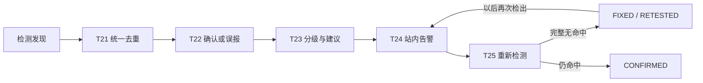

# D 模块这几天做了什么（截至 2026-10-17）

## 1. D 模块的职责

D 负责将检测结果做成可追踪的风险闭环：识别敏感信息，统一、去重检测结果，确认真假，确定风险等级，发出告警，再检查修复是否有效。清单对应 T20—T26，另有 T47 演示环境说明。系统中的一条风险记录叫 Finding，既保存发现证据，也保存处理状态。

## 2. 每天完成的内容

| 工作日期 | 任务 | 用日常语言说明 | 主要验证 |
| --- | --- | --- | --- |
| 10 月 12 日 | T20 敏感信息检测 | 检查已采集正文/响应头，找关键词、手机号等格式、敏感文件类型及样例特征；输出脱敏位置与规则依据 | F 的 D-01—D-03 正例和 E-04 负例，四类规则及授权/资源边界 |
| 10 月 13 日 | T21 归一化与去重 | 各工具输出格式不同，先统一成 Finding；同资产、同风险多次出现归成一条，更新出现时间和轮次 | 39 项专项、10 个离线场景 |
| 10 月 14 日（15 日补齐提交） | T22 结果验证 | 运维可将待确认风险标记为确认或误报，记录谁在何时按什么依据处理 | 38 项专项、16 个场景；权限、同源证据、事务回滚 |
| 10 月 15 日 | T23 分级模型 | 按已有漏洞分数、命中规则、页面重要性和暴露范围排优先级，补影响与建议 | 36 项专项、18 个场景；配置生效、边界与安全输出 |
| 10 月 16 日 | T24 告警 | 达到规则就放入站内收件箱；重复巡检不反复提醒，修复后再出现才新告警 | 41 项专项、17 个场景；跨任务、并发、修复周期及权限 |
| 10 月 17 日 | T25 复测闭环 | 重新运行原检测，确定修复、仍有风险或无法判断；保存历史并同步告警周期 | 45 项专项、17 个场景；真实离线规则、幂等、并发及失败保留状态 |

## 3. 用一个案例串起来

测试页面含有合成令牌 `DEMO_ACCESS_TOKEN`（演示标记）。T20 找到标记并脱敏；T21 将不同来源或重复巡检的同一风险归并；T22 允许运维核对证据并确认风险；T23 根据规则和暴露范围确定处置等级；T24 产生一次站内告警，后续重复检测保留同一周期。

规则命中首先是候选风险。例如公开客服邮箱也可能被格式规则匹配，若业务确认允许公开，可经 T22 标记为误报；不能单凭格式匹配断言发生泄露。

内容修复后，T25 在可信目标与原规则绑定下重新检测。完整成功且不再命中才标记 FIXED，并结束该告警周期；再次完整复测通过为 RETESTED。仍命中则 CONFIRMED，超时或证据不足保留原状态。以后同风险重新出现，开启新周期并再次告警。把告警点成“已读”或“关闭”本身不会证明风险已经修复。

## 4. 这些功能如何完成

先读清单及 SRS/SDD，明确每个任务的输入、输出和验收边界；细节不充分时先补实现契约，随 PR 评审。代码按接口、业务服务、数据仓储分层，规则放在配置中，避免不同位置各算一套。

测试使用固定正负样例和合成记录，先验证正常行为，再验证容易出错的情况：未经授权、误报、重复请求、并发修改、乱序结果、超时和审计失败。T25 特别验证“检测过程中状态变了不能覆盖”和“旧执行晚到不能覆盖新执行”。结果保存为可重复生成的 JSON 报告，并附复现命令。

最后将代码、规格、测试、报告和每日简报提交独立功能分支，通过 GitHub PR 评审。代码提交不等于已经上线；各分支的单元总数也不能直接相加当作全系统验收结果。

## 5. 当前进度与后续工作

T20—T22 的实现已包含在当前主分支基线。T23 通过 [PR #6](https://github.com/SOLECA794/AnHeng-work/pull/6)、T24 通过 [PR #7](https://github.com/SOLECA794/AnHeng-work/pull/7) 提交，10 月 17 日核对时仍待合并；T25 通过 [PR #8](https://github.com/SOLECA794/AnHeng-work/pull/8) 接在 T24 上提交，先合 T24 再合 T25。

目前完成的是独立实现与本地验收。真实登录鉴权、PostgreSQL、前端、授权站点采集、平台及在线流水线仍需联调；T25 已有真实敏感信息离线 runner，其它工具的在线复测适配继续接入。告警提供站内收件箱，邮件尚未配置。

10 月 18 日下一项是 T26：将这些风险、证据摘要、处理状态和建议整理成可核对、可导出的报告；T47 演示环境说明仍在后续清单中。
